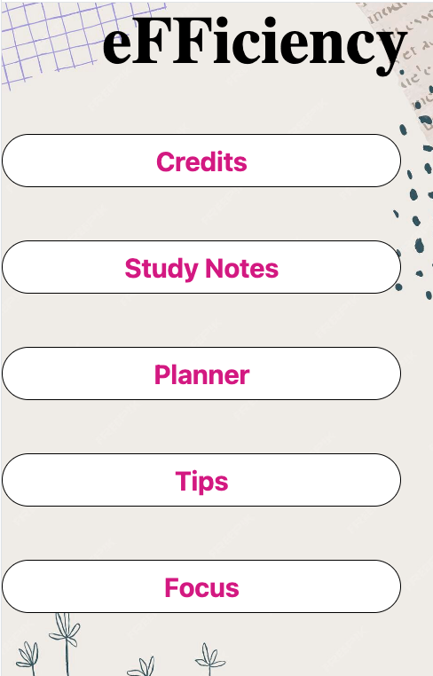
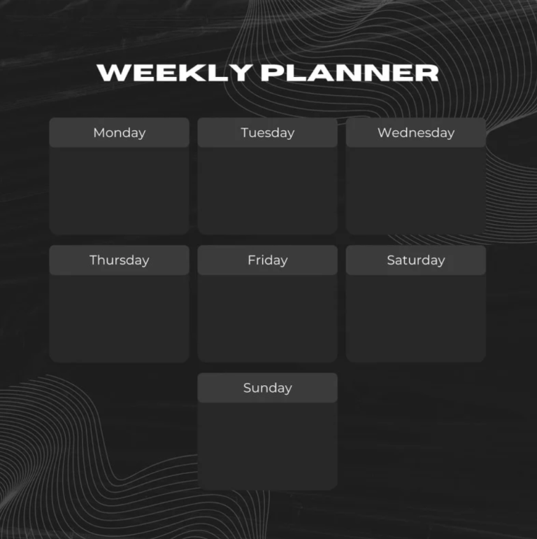

# eFFiciency: Study Productivity App

A mobile study-productivity app that won **1st place in the high school category at the Synthacks Hackathon 2022**. It brings a weekly timetable, a notes pad and study tips into one simple app.

Built with React Native and Expo (JavaScript).

## Screenshots

| Home | Planner |
|------|---------|
|  |  |

## Hackathon result

This app was built for the Synthacks Hackathon 2022 at Greenwood High International School, Bangalore, held on 17 and 18 August 2022. It won **1st place** in the high school category.

| Award | Details |
|-------|---------|
| Trophy | 1st Place, High School, Synthacks Hackathon 2022 |
| Certificate of Merit | 1st place in Synthacks Hackathon 2022, awarded to Sejal Gupta of Standard 9, dated 18 August 2022 |
| Participation Certificate | Participated in the Greenwood High Synthacks Hackathon 2022, held on 17 and 18 August 2022 |

| Trophy | Participation Certificate | Certificate of Merit |
|--------|---------------------------|----------------------|
|  |  |  |

## Features

- **Home:** five buttons leading to each section of the app.
- **Planner:** a Monday to Friday weekly timetable view with colour-coded class blocks. Tapping a block shows its details. The timetable currently shows sample data.
- **Study Notes:** a plain text pad for quick notes.
- **Tips:** ten study techniques, including spaced repetition, the Pomodoro technique and PQ4R.
- **Focus:** screen reserved for a focus timer (not built yet).
- **Credits:** names the app and website teams. The app was made by Sejal Gupta and Arjun Kulkarni.

## Setup

Requires Node.js 16 or later and the Expo Go app on your phone.

```
git clone https://github.com/Sejal116/Hackathon-2022---SAAR.git
cd Hackathon-2022---SAAR
npm install
npx expo start
```

Scan the QR code with Expo Go (Android) or the Camera app (iOS). The app targets Expo SDK 46, so very recent Expo Go versions may need `npx expo install --fix` first.

## How it works

```
App.js              switch navigator that links all screens
screens/
  HomeScreen.js     menu with five buttons
  Planner.js        weekly timetable (react-native-timetable), sample events array
  StudyNotes.js     multiline text input
  Tips.js           list of ten study techniques
  Focus.js          placeholder for the timer
  Credits.js        credits screen
```

Navigation uses `createSwitchNavigator` from react-navigation. Each screen is a React class component, and the Planner reads an array of events, each with a title, start time, end time and location.

## Limitations and next steps

- Timetable entries are hard-coded. Next step: let users add, edit and delete classes, and save them on the device.
- Notes are not saved between sessions. Next step: store them with AsyncStorage.
- Add the Pomodoro timer on the Focus screen.
- Add clash detection between overlapping classes and reminder notifications.
- Add calendar sync with Google and Outlook.
