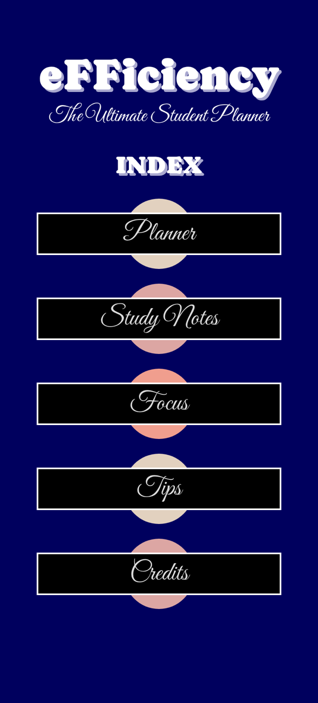
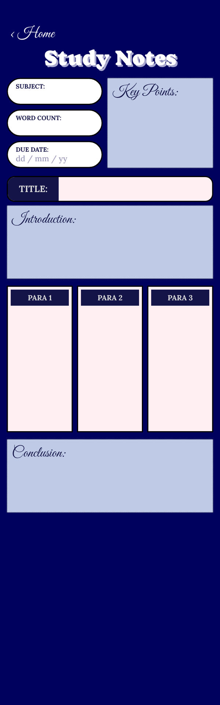
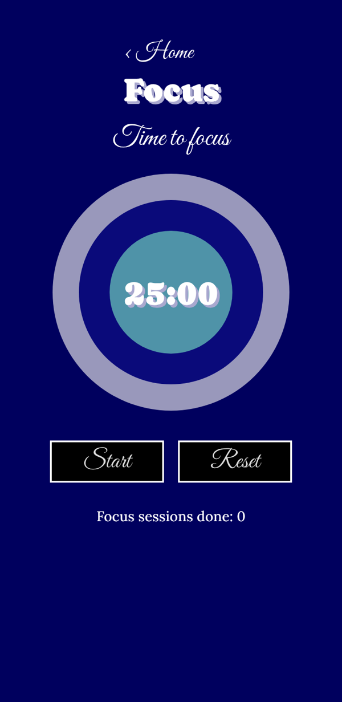
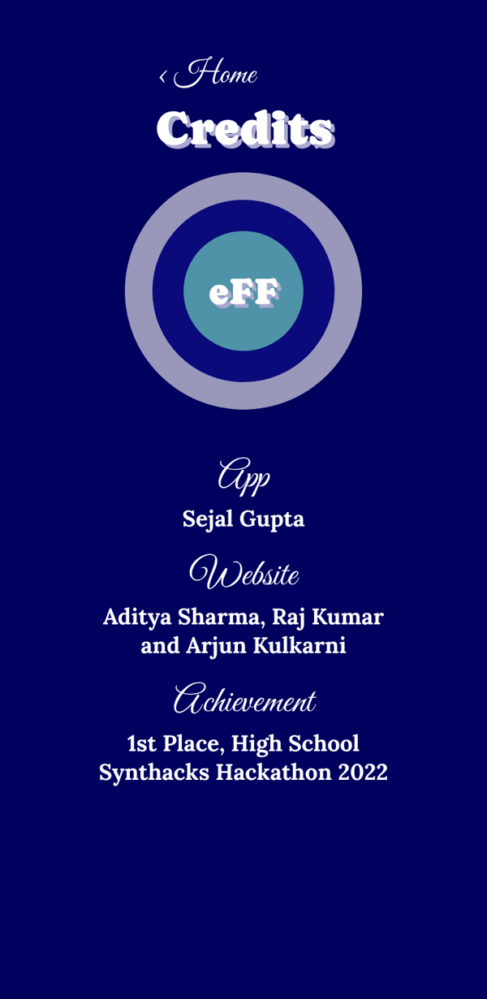
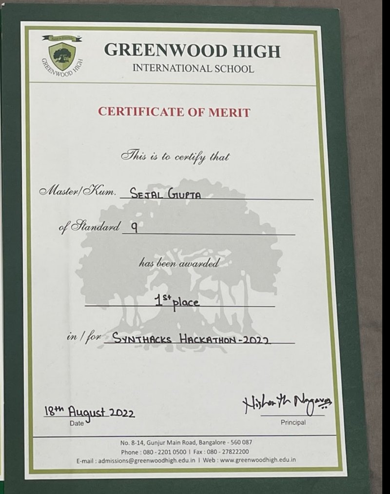

# eFFiciency: Study Productivity App

A mobile study-productivity app that won **1st place in the high school category at the Synthacks Hackathon 2022**. It brings a weekly timetable, a notes pad and study tips into one simple app.

Built with React Native and Expo (JavaScript).

## Screenshots

The app uses a navy planner design with script headings and pink grid cards.

| Home | Planner | Study Notes |
|------|---------|-------------|
|  |  |  |

| Focus | Tips | Credits |
|-------|------|---------|
|  |  |  |

## Hackathon result

This app was built for the Synthacks Hackathon 2022 at Greenwood High International School, Bangalore, held on 17 and 18 August 2022. It won **1st place** in the high school category. The core flow of the app was built in 12 hours.

| Award | Details |
|-------|---------|
| Trophy | 1st Place, High School, Synthacks Hackathon 2022 |
| Certificate of Merit | 1st place in Synthacks Hackathon 2022, awarded to Sejal Gupta of Standard 9, dated 18 August 2022 |
| Participation Certificate | Participated in the Greenwood High Synthacks Hackathon 2022, held on 17 and 18 August 2022 |

| Trophy | Participation Certificate | Certificate of Merit |
|--------|---------------------------|----------------------|
|  |  |  |

## Features

- **Home:** an index page with five sections, styled like a planner contents page.
- **Planner:** a weekly planner with a card for each day, plus a Weekly Priorities box. Tapping a class shows its time and room. The classes shown are sample data.
- **Study Notes:** an essay planner page with boxes for subject, word count, due date, key points, title, introduction, three body paragraphs and a conclusion.
- **Focus:** a Pomodoro timer with 25 minute focus sessions and 5 minute breaks, with start, pause and reset, and a count of finished sessions.
- **Tips:** ten study techniques, including spaced repetition, the Pomodoro technique and PQ4R.
- **Credits:** names the app and website teams. The app was made by Sejal Gupta. The website was made by Aditya Sharma, Raj Kumar and Arjun Kulkarni.

## Setup

Requires Node.js 16 or later and the Expo Go app on your phone.

```
git clone https://github.com/Sejal116/Hackathon-2022---SAAR.git
cd Hackathon-2022---SAAR
npm install
npx expo start
```

Scan the QR code with Expo Go (Android) or the Camera app (iOS). The app targets Expo SDK 46, so very recent Expo Go versions may need `npx expo install --fix` first.

## How it works

```
App.js              loads the fonts and links all screens with a switch navigator
theme.js            shared colours, fonts and title shadow
components/
  Header.js         back button and page title
screens/
  HomeScreen.js     index page with five buttons
  Planner.js        weekly planner, sample SCHEDULE array
  StudyNotes.js     essay planner with text boxes
  Focus.js          Pomodoro timer
  Tips.js           list of ten study techniques
  Credits.js        credits screen
assets/fonts/       Caprasimo, Great Vibes and Lora
```

Navigation uses `createSwitchNavigator` from react-navigation. Every screen is a React class component. The Focus screen keeps its countdown in component state and updates it once a second with `setInterval`.

## Limitations and next steps

- The Planner classes are hard-coded. Next step: let users add, edit and delete classes, and save them on the device.
- Notes and priorities are not saved between sessions. Next step: store them with AsyncStorage.
- Add clash detection between overlapping classes and reminder notifications.
- Add calendar sync with Google and Outlook.
